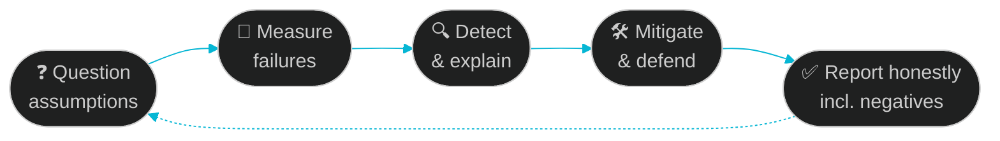

<!-- ============================================================
     MIHIT NANDA | AI RESEARCH LAB  ·  v3 — Navy / Cyan
     Repo: github.com/mihiit/mihiit  (profile README)
============================================================ -->

<div align="center">


<br/>

<a href="https://github.com/mihiit"></a>
<a href="https://orcid.org/0009-0003-7849-6106"></a>
<a href="https://www.linkedin.com/in/mihit-nanda"></a>
<a href="https://mihitnandaportfolio.netlify.app"></a>

<br/>


<br/><br/>

<table>
<tr>
<td align="center">

📣 **Upcoming:** presenting two accepted papers at **IEEE ICTACS · 3–4 December 2026**<br/>
<sub>ProbeGuard (federated backdoor defense) · Is It the Beliefs? (hidden-rule discovery)</sub>

</td>
</tr>
</table>

</div>

<br/>
<div align="center">

</div>

<div align="center">


*Understanding, evaluating, and engineering trustworthy intelligent systems.*

</div>

<div align="center">

</div>

<br/>


<table>
<tr>
<td width="62%" valign="top">

I'm **Mihit Nanda**, a Computer Science researcher (B.Tech, IILM University) working at the intersection of **machine learning**, **AI reliability**, and **trustworthy, secure AI**.

My work asks *when can an internal signal be trusted and acted upon?* I study how learning systems fail under uncertainty and distribution shift, and build **rigorous evaluation methods and diagnostics**, including pre-specified tests, leakage-controlled benchmarks, and honest reporting of **negative results**, particularly for safety-critical AI.

> *A system that performs well is not necessarily a system that can be trusted.*

</td>
<td width="38%" valign="top">

```yaml
researcher:
  name: Mihit Nanda
  papers: 9  # 5 accepted · 4 in review
  focus: [Reliability, Safety]
  studies: LLMs · FL · Agents
  method: Measure → Break → Fix
  now: ICTACS · Dec 3–4, 2026
  founder: FedGuard
  status: Open to collaboration
```

</td>
</tr>
</table>

<br/>


<table>
<tr>
<td width="33%" valign="top">

### 🧠 LLM Reliability
`Hallucination detection`
`Hidden-state probing`
`Failure prediction`
`Cross-model generalization`

</td>
<td width="33%" valign="top">

### 🛡️ AI Safety
`Adversarial robustness`
`Reliability engineering`
`Failure analysis`
`Trustworthy AI`

</td>
<td width="33%" valign="top">

### 🌐 Federated Learning
`Backdoor attacks & defenses`
`Non-IID heterogeneity`
`Formal analysis`
`Robustness evaluation`

</td>
</tr>
<tr>
<td width="33%" valign="top">

### 🔬 Evidence & Health AI
`Confirmation-loop bias`
`Clinical evidence (MIMIC-IV)`
`Temporal reliability`
`Explanation faithfulness`

</td>
<td width="33%" valign="top">

### 🤖 AI Agents
`Persistent memory`
`Repository understanding`
`Evidence-aware retrieval`
`Hidden-rule discovery`

</td>
<td width="33%" valign="top">

### 📊 Empirical ML
`Pre-specified hypotheses`
`Holm-corrected testing`
`Leakage-controlled evaluation`
`Reproducible code release`

</td>
</tr>
</table>

<div align="center">



</div>

<br/>


<div align="center">


</div>

### ✅ Accepted

| # | Paper | Venue | Key finding |
|:-:|:--|:--|:--|
| 1 | **Score Quality Versus Decision Quality: Why Behavioural Trigger Probing for Federated Backdoors Fails Under Heterogeneity** *(ProbeGuard)*<br/><sub>M. Nanda (first), S. Tiwari · [Preprint DOI](https://doi.org/10.5281/zenodo.23447483)</sub> | **IEEE ICTACS**<br/>presenting 3–4 Dec 2026 | Score stays informative (AUROC ≥ 0.95 for α ≥ 0.5) while a fixed MAD threshold collapses (TPR 0.0 at α=0.1 vs 0.94 at α=10); a rank-based rule recovers most of the gap |
| 2 | **Is It the Beliefs? A Matched-Information Study of Hidden-Rule Discovery by Hypothesis-Testing, Bayesian and Learned Agents**<br/><sub>M. Nanda (first), S. Tiwari · [Preprint DOI](https://doi.org/10.5281/zenodo.23755359)</sub> | **IEEE ICTACS**<br/>presenting 3–4 Dec 2026 | Belief-augmented learned agent matches the hypothesis tracker (Δ = −0.001); plain Macro-GRU trails by 0.186 |
| 3 | **Memory That Remembers Wrong: Confirmation-Loop Bias in LLM Health Agents**<br/><sub>M. Nanda (co-author), H. Nagpall, A. Goyal</sub> | **AI4S Conference**<br/>accepted Oct 2026 | Counter-evidence framework mitigating confirmation-loop bias, evaluated on MIMIC-IV clinical data |
| 4 | **The Faithfulness Paradox in Hate Speech Detection**<br/><sub>M. Nanda (first), H. Nagpall, A. Goyal</sub> | **AI4S Conference**<br/>accepted Oct 2026 | Compares explanation faithfulness and energy efficiency across linear and neural classifiers |
| 5 | **VoteChain: Decentralized Commit–Reveal Voting Using Ethereum Smart Contracts**<br/><sub>M. Nanda (first) · [Published article](https://www.indjcst.com/archives/vote-chain-a-decentralized-commit-reveal-voting-framework-using-ethereum-smart-contracts-and-cryptographic-hash-verification)</sub> | **INDJCST**<br/>Published | Keccak256 commit–reveal in Solidity keeps ballots secret without homomorphic-encryption overhead; 14 unit tests |

### 🔄 Under Review

| # | Paper | Venue | Key finding |
|:-:|:--|:--|:--|
| 6 | **Retrieving Over Evidence Items: Repository Memory for Coding Agents, Evaluated on Real Git History** *(EmemoVeri)*<br/><sub>M. Nanda (first), P. Tyagi · [Preprint DOI](https://doi.org/10.5281/zenodo.23447572)</sub> | **IEEE ESCI**<br/>under review | EmemoVeri-2 beats snapshot retrieval by **+0.132 Hit@5** on 16 unseen repos (5,832 tasks, Holm p < 0.001) |
| 7 | **Heterogeneity-Dependent Backdoor Defence Collapse in Federated Learning: Formal Analysis, Novel Defences, and a Four-Dataset Cross-Benchmark Study**<br/><sub>M. Nanda (first) · [Preprint DOI](https://doi.org/10.5281/zenodo.21525311)</sub> | **J. Computer Virology & Hacking Techniques** (Springer)<br/>under review | Proves a correction to GradSplit; **DualGuard** holds ASR to 0.99% (A3FL) and 3.30% (RMC) on Digits vs 46.60% / 18.21% for GradSplit |
| 8 | **Hallucination Detection via Linear Probes across GPT-2, TinyLlama, and Phi-2**<br/><sub>M. Nanda (first) · [Preprint DOI](https://doi.org/10.5281/zenodo.21334079)</sub> | **SN Computer Science** (Springer) | Linear probes on hidden states reach up to **0.858 AUROC** |
| 9 | **Hidden-State Trajectory Features for LLM Hallucination Detection: A Length-Controlled Evaluation Against Static Probes**<br/><sub>M. Nanda (first), P. Tyagi · [Preprint DOI](https://doi.org/10.5281/zenodo.23755550)</sub> | **IEEE ESCI**<br/>under review | Pre-specified 900-question test: trajectory features did *not* beat a tuned static probe (0.732 vs 0.753), a reported negative result |

<div align="center">
<a href="https://orcid.org/0009-0003-7849-6106"></a>
</div>

<br/>


<table>
<tr>
<td width="50%" valign="top">

<a href="https://github.com/mihiit/BackdoorAttacks">

</a>

### `01` BackdoorAttacks / DualGuard
**Federated Learning Security & Reproducibility**

Reproducible package for federated-learning backdoor attacks and defense evaluation across four benchmarks (Digits, MNIST, CIFAR-10, LEAF FEMNIST).

- DualGuard: ASR held to **0.99%** (A3FL) vs 46.60% for GradSplit
- Formal fix to a consensus-contamination flaw in GradSplit
- Attack/defense code, pipelines, figures


**[↗ Explore Repository](https://github.com/mihiit/BackdoorAttacks)**

</td>
<td width="50%" valign="top">

<a href="https://github.com/mihiit/Ememoveri_Repo">

</a>

### `02` EmemoVeri
**Evidence-Aware Repository Memory**

Evidence-ledger memory for coding agents that tracks deletions, renames and reverts, with a leakage-controlled benchmark built from real git history.

- **+0.132 Hit@5** over snapshot retrieval on 16 unseen repos
- Beats a tuned recency+popularity baseline by 0.043
- Reports a negative result on the original design


**[↗ Explore Repository](https://github.com/mihiit/Ememoveri_Repo)**

</td>
</tr>
<tr>
<td width="50%" valign="top">

<a href="https://github.com/mihiit/Backdoorfed-ICTACS">

</a>

### `03` ProbeGuard
**Federated Backdoor Defense · IEEE ICTACS**

Behavioural trigger probing and federated backdoor defense under non-IID data.

- Late-round AUROC ≥ 0.95 for Dirichlet α ≥ 0.5
- Fixed threshold: TPR 0.0 at α=0.1; rank-based rule recovers most of the gap
- Tested vs a probe-aware adaptive attacker and CIFAR-10


**[↗ Explore Repository](https://github.com/mihiit/Backdoorfed-ICTACS)**

</td>
<td width="50%" valign="top">

<a href="https://github.com/mihiit/RuleDiscovery">

</a>

### `04` RuleDiscovery
**Hidden-Rule Discovery by Intelligent Agents · IEEE ICTACS**

Controlled benchmark comparing hypothesis-testing, Bayesian and learned agents in procedural rule-discovery environments.

- Belief-augmented learned agent matches hypothesis tracker (Δ = −0.001)
- Plain Macro-GRU trails by 0.186
- Posterior-sampling baselines included


**[↗ Explore Repository](https://github.com/mihiit/RuleDiscovery)**

</td>
</tr>
<tr>
<td colspan="2" valign="top">

<a href="https://github.com/mihiit/hallutrace">

</a>

### `05` HalluTrace
**Representation-Based Hallucination Detection**

Do internal language-model representations reveal hallucinations and enable more reliable evaluation?

- Linear probes across GPT-2, TinyLlama and Phi-2: up to **0.858 AUROC**
- Pre-specified, length-controlled test of trajectory features vs static probes (negative result: 0.732 vs 0.753)
- Cross-model, cross-dataset and early-detection ablations


**[↗ Explore Repository](https://github.com/mihiit/hallutrace)**

</td>
</tr>
</table>

<div align="center">
<a href="https://github.com/mihiit?tab=repositories"></a>
</div>

#### More projects

| Project | What it does | Stack |
|:--|:--|:--|
| **VoteChain** | Commit–reveal e-voting DApp: keccak256 ballot hashing, 14 Solidity unit tests, admin dashboard, MetaMask voter flow | `Solidity` `React` `Web3.js` `Python` |
| **NeuroBalance** | Flags depression and anxiety risk indicators from survey features, served via REST API | `XGBoost` `Django` `React` |

<br/>


<table>
<tr>
<td width="50%" valign="top">


### Early Warning for LLM Failures
Tests whether hidden-state dynamics give an *early warning* of unreliable output, scored by lead time, false-assurance rate and calibration. Validated end-to-end on Qwen2.5-0.5B-Instruct. Built at Sustain-A-Thon 2.0.


</td>
<td width="50%" valign="top">


### Federated Threat-Detection Platform
Founder-stage prototype: organizations jointly train threat-detection models via encrypted local updates, keeping raw security, customer and PII data on-premise.

[](https://www.fedguard.in/)

</td>
</tr>
<tr>
<td width="50%" valign="top">


### Functional Similarity Across Neural Networks
Do independently trained networks converge toward functionally similar solutions despite different initializations and optimization trajectories?


</td>
<td width="50%" valign="top">


### Clinical Evidence Conflict & Temporal Reliability
Conflicting clinical evidence, temporal change, and reliability in evidence-driven AI systems.


</td>
</tr>
</table>

<sub>Some of these directions are not yet public GitHub repositories.</sub>

<br/>


| When | Role | Where | Highlights |
|:--|:--|:--|:--|
| **Sep – Dec 2026** | 🔬 Research Intern, Backdoor Detection in FL | Sharda University · Dr. Sanju Tiwari | Developed ProbeGuard; matched-information hidden-rule study; **two IEEE ICTACS acceptances** |
| **Jul – Aug 2026** | 🔬 Research Collaborator | Texas A&M University–Kingsville · Dr. Ayush Goyal | Two AI4S papers: confirmation-loop bias in LLM health agents; explanation faithfulness |
| **Ongoing** | 🚀 Founder, [FedGuard](https://www.fedguard.in/) | Prototype stage | Federated threat-detection platform that keeps raw data on-premise |
| **Jun – Jul 2026** | 💼 CS Intern | Steel Authority of India Ltd. (SAIL) | Built an internal IT service-management portal for submitting and tracking issues |
| **Jun – Aug 2025** | 💼 Frontend Engineering Intern | GSPANN Technologies | Frontend work on a client project (Sephora) |
| **Aug 2023 – May 2027** | 🎓 B.Tech, Computer Science | IILM University, India | CGPA 7.81 / 10 · TOEFL iBT 100 |

<br/>


<table>
<tr>
<td width="50%" valign="top">

### 🏆 Leadership & Awards
- **Head, AI/ML Club**, IILM University (2024–25)
- **Sustain-A-Thon 2.0**, Sharda University (Oct 2026): built Reliability Lab
- **IILM Tech Fest:** 🥇 1st Prize, Technical Drama · Top 5, Technical Debate
- **Volunteer**, Friends JanSewa Samiti: health & education outreach (2023–present)

</td>
<td width="50%" valign="top">

### 📚 Certifications
- Probabilistic Graphical Models: Stanford (Coursera)
- Mathematics for Machine Learning: Imperial College London (Coursera)
- Python for Everybody: University of Michigan (Coursera)
- Data Structures using Python: UC San Diego (Coursera)
- Oracle Cloud Infrastructure 2025 Generative AI Professional

</td>
</tr>
</table>

<br/>


<div align="center">

<table>
<tr>
<td align="center" width="33%"><b>⌨️ Languages</b><br/><br/>
</td>
<td align="center" width="33%"><b>🧠 ML & AI</b><br/><br/>
</td>
<td align="center" width="33%"><b>⚙️ Web & Infra</b><br/><br/>
</td>
</tr>
</table>


<br/><br/>

**Research methods:** pre-specified hypotheses · leakage/length-controlled evaluation · Holm-corrected testing · AUROC & calibration · adaptive-attacker evaluation · negative-result reporting · reproducible code release

</div>

<br/>


<div align="center">


<br/><br/>


<br/>


<br/><br/>


</div>

<br/>


<div align="center">

**3D contribution skyline**


<br/>

**The contribution snake 🐍**

<picture>
  <source media="(prefers-color-scheme: dark)" srcset="https://raw.githubusercontent.com/mihiit/mihiit/output/github-contribution-grid-snake-dark.svg"/>
  <source media="(prefers-color-scheme: light)" srcset="https://raw.githubusercontent.com/mihiit/mihiit/output/github-contribution-grid-snake.svg"/>
  
</picture>

<a href="https://github.com/mihiit?tab=overview"></a>

</div>

<br/>


<div align="center">

<a href="https://github.com/mihiit"></a>
<a href="https://www.linkedin.com/in/mihit-nanda"></a>
<a href="https://orcid.org/0009-0003-7849-6106"></a>
<a href="https://mihitnandaportfolio.netlify.app"></a>

<br/><br/>

**Open to research collaborations and discussions in reliable AI, machine learning, and AI safety.**


</div>
