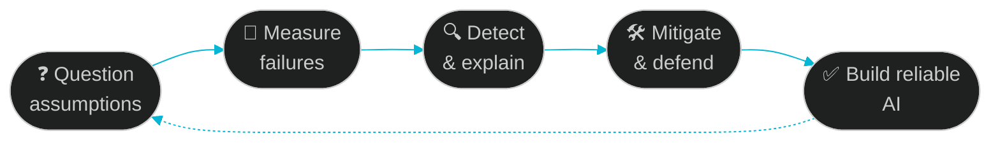
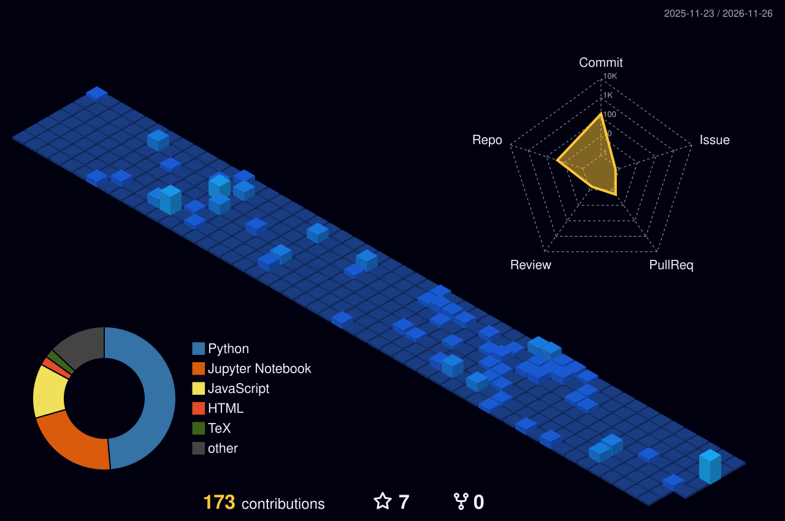

<!-- ============================================================
     MIHIT NANDA | AI RESEARCH LAB  ·  v2 — Deep Navy / Cyan
     Repo: github.com/mihiit/mihiit  (profile README)
============================================================ -->

<div align="center">


<br/>

<a href="https://github.com/mihiit"></a>
<a href="https://orcid.org/0009-0003-7849-6106"></a>


</div>

<br/>

<div align="center">

</div>

<div align="center">


*Understanding, evaluating, and engineering trustworthy intelligent systems.*

</div>

<div align="center">

</div>

<br/>

<!-- ───────────────────────── 01 ABOUT ───────────────────────── -->


<table>
<tr>
<td width="62%" valign="top">

I'm **Mihit Nanda**, a Computer Science researcher working at the intersection of **machine learning**, **AI reliability**, and **trustworthy intelligent systems**.

My work explores how learning systems behave under uncertainty, why they fail, and how those failures can be **detected, measured, and mitigated**.

Research interests: empirical ML · LLM reliability · AI safety · federated learning · scientific ML · autonomous AI agents.

> *A system that performs well is not necessarily a system that can be trusted.*

</td>
<td width="38%" valign="top">

```yaml
researcher:
  name: Mihit Nanda
  focus: [Reliability, Safety]
  studies: LLMs · FL · Agents
  method: Measure → Break → Fix
  status: Open to collaboration
  motto: "Question assumptions."
```

</td>
</tr>
</table>

<br/>

<!-- ───────────────────────── 02 DOMAINS ───────────────────────── -->


<table>
<tr>
<td width="33%" valign="top">

### 🧠 LLM Reliability
`Hallucination detection`
`Internal representations`
`Failure prediction`
`Cross-model generalization`

</td>
<td width="33%" valign="top">

### 🛡️ AI Safety
`Adversarial robustness`
`Reliability engineering`
`Failure analysis`
`Trustworthy AI`

</td>
<td width="33%" valign="top">

### 🌐 Federated Learning
`Backdoor attacks`
`Non-IID heterogeneity`
`Defense mechanisms`
`Robustness evaluation`

</td>
</tr>
<tr>
<td width="33%" valign="top">

### 🔬 Scientific ML
`Numerical stability`
`Reproducibility`
`Optimization`
`Computational reliability`

</td>
<td width="33%" valign="top">

### 🤖 AI Agents
`Persistent memory`
`Repository understanding`
`Evidence-aware retrieval`
`Agent reliability`

</td>
<td width="33%" valign="top">

### 📊 Empirical ML
`Experimental design`
`Statistical evaluation`
`Generalization`
`Reproducible research`

</td>
</tr>
</table>

<div align="center">



</div>

<br/>

<!-- ───────────────────────── 03 FEATURED ───────────────────────── -->


<table>
<tr>
<td width="50%" valign="top">

<a href="https://github.com/mihiit/BackdoorAttacks">

</a>

### `01` BackdoorAttacks
**Federated Learning Security & Reproducibility**

A reproducible experimental package for federated-learning backdoor attacks and defense evaluation.

- Attack and defense implementations
- Dataset and simulation pipelines
- Experiment results and figure generation


**[↗ Explore Repository](https://github.com/mihiit/BackdoorAttacks)**

</td>
<td width="50%" valign="top">

<a href="https://github.com/mihiit/Ememoveri_Repo">

</a>

### `02` EmemoVeri
**Evidence-Aware Repository Memory**

A repository memory system for coding agents that keeps evidence about source files and tracks whether remembered information is still current.

- Evidence-backed memory records
- Git-history-based retrieval
- File changes, renames and deletions


**[↗ Explore Repository](https://github.com/mihiit/Ememoveri_Repo)**

</td>
</tr>
<tr>
<td width="50%" valign="top">

<a href="https://github.com/mihiit/Backdoorfed-ICTACS">

</a>

### `03` ProbeGuard
**Federated Backdoor Defense**

Researching behavioral trigger probing and federated backdoor defense under non-IID data.

- Behavioral trigger probing
- Ranking versus filtering behavior
- Defense evaluation under heterogeneity


**[↗ Explore Repository](https://github.com/mihiit/Backdoorfed-ICTACS)**

</td>
<td width="50%" valign="top">

<a href="https://github.com/mihiit/RuleDiscovery">

</a>

### `04` RuleDiscovery
**Hidden-Rule Discovery by Intelligent Agents**

A controlled benchmark comparing hypothesis-testing, Bayesian and learned agents in procedural rule-discovery environments.

- Hypothesis-driven agents
- Posterior-sampling baselines
- Learned policy comparisons


**[↗ Explore Repository](https://github.com/mihiit/RuleDiscovery)**

</td>
</tr>
<tr>
<td colspan="2" valign="top">

<a href="https://github.com/mihiit/hallutrace">

</a>

### `05` HalluTrace
**Representation-Based Hallucination Detection**

Investigating whether internal language-model representations can reveal hallucinations and support more reliable model evaluation.

- Hidden-state representation probing · Cross-model generalization
- Cross-dataset evaluation · Early detection and ablation experiments


**[↗ Explore Repository](https://github.com/mihiit/hallutrace)**

</td>
</tr>
</table>

<div align="center">
<a href="https://github.com/mihiit?tab=repositories"></a>
</div>

<br/>

<!-- ───────────────────────── 04 IN PROGRESS ───────────────────────── -->


<table>
<tr>
<td width="50%" valign="top">


### Functional Similarity Across Neural Networks

Investigating whether independently trained networks converge toward functionally similar solutions despite differences in initialization and optimization trajectories.


</td>
<td width="50%" valign="top">


### Clinical Evidence Conflict & Temporal Reliability

Investigating conflicting clinical evidence, temporal change, and reliability in evidence-driven AI systems.


</td>
</tr>
</table>

<sub>These are active research directions, not yet publicly released GitHub repositories.</sub>

<br/>

<!-- ───────────────────────── 05 TECH ───────────────────────── -->


<div align="center">

<table>
<tr>
<td align="center" width="33%"><b>⌨️ Languages</b><br/><br/>
</td>
<td align="center" width="33%"><b>🧠 ML & AI</b><br/><br/>
</td>
<td align="center" width="33%"><b>⚙️ Infra & Frameworks</b><br/><br/>
</td>
</tr>
</table>


</div>

<br/>

<!-- ───────────────────────── 06 PUBLICATIONS ───────────────────────── -->


My academic work investigates:

- 🧠 Trustworthy and reliable large language models
- 🌐 Adversarial robustness in federated learning
- 🔍 Internal representation dynamics and hallucination detection
- 🤖 Memory reliability in autonomous AI systems
- 📊 Reproducible empirical machine learning

<div align="center">
<a href="https://orcid.org/0009-0003-7849-6106"></a>
</div>

<br/>

<!-- ───────────────────────── 07 ACHIEVEMENTS ───────────────────────── -->


<div align="center">

</div>

<br/>

<!-- ───────────────────────── 08 ANALYTICS ───────────────────────── -->


<table>
<tr>
<td width="50%" align="center" valign="middle">

</td>
<td width="50%" align="center" valign="middle">

</td>
</tr>
</table>

<div align="center">

</div>

<br/>

<div align="center">

</div>

<br/>

<!-- ───────────────────────── 09 CONTRIBUTIONS ───────────────────────── -->


<div align="center">

**3D contribution skyline**



<br/>

**The contribution snake 🐍**

<picture>
  <source media="(prefers-color-scheme: dark)" srcset="https://raw.githubusercontent.com/mihiit/mihiit/output/github-contribution-grid-snake-dark.svg"/>
  <source media="(prefers-color-scheme: light)" srcset="https://raw.githubusercontent.com/mihiit/mihiit/output/github-contribution-grid-snake.svg"/>
  
</picture>

<a href="https://github.com/mihiit?tab=overview"></a>

</div>

<br/>

<!-- ───────────────────────── 10 CONNECT ───────────────────────── -->


<div align="center">

<a href="https://github.com/mihiit"></a>
<a href="https://orcid.org/0009-0003-7849-6106"></a>

<br/><br/>

**Open to research collaborations and discussions in reliable AI, machine learning, and AI safety.**


</div>
